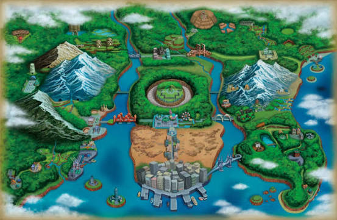

# Unova Assets

Public image repository for PokéBot’s Unova region map.

## Map

**Asset path:** `assets/region/unova-map.jpg`  
**Raw URL:** https://raw.githubusercontent.com/TheSunphis/unova-assets/main/assets/region/unova-map.jpg
